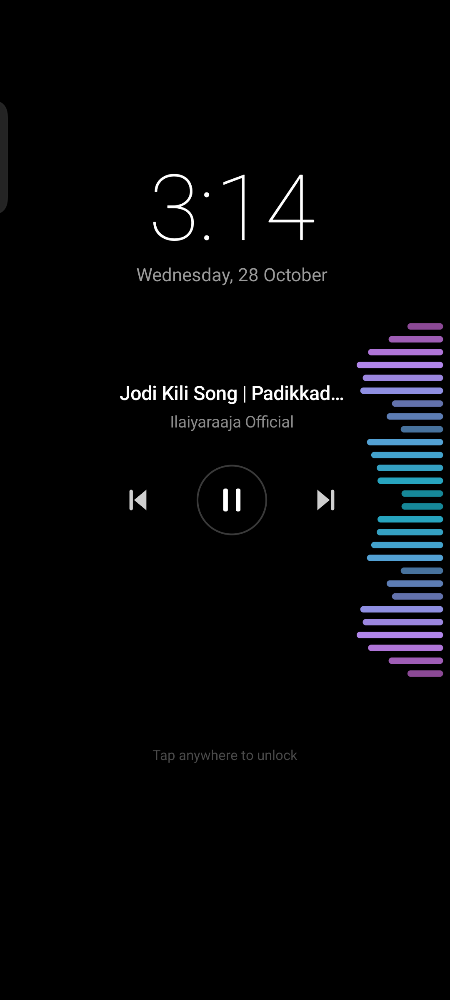
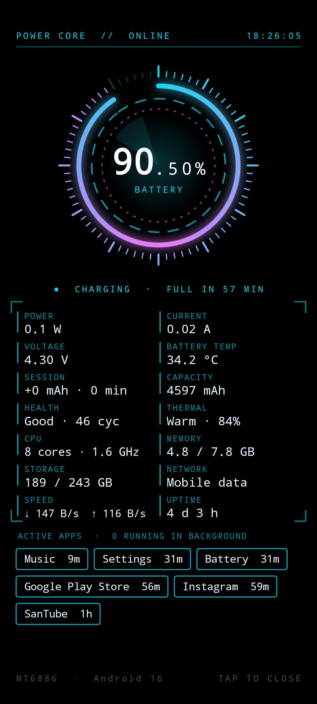
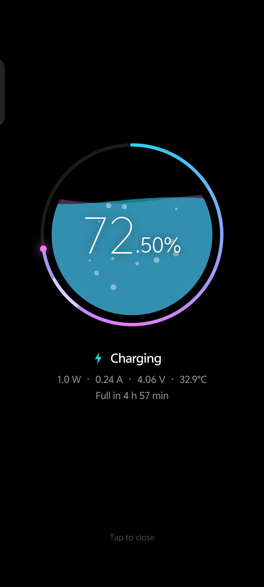
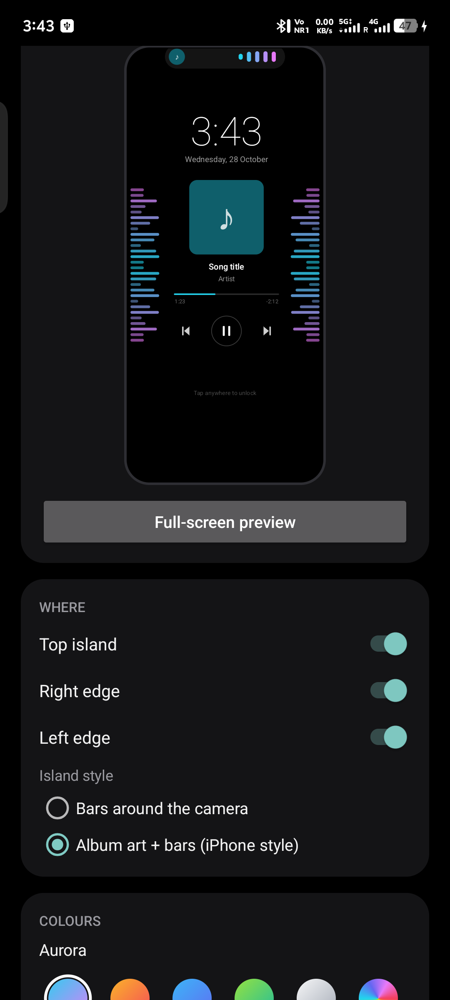

# Music AOD

A lock-screen companion for Android. **Music AOD** shows a live music visualizer when you lock your phone during a song, and a charging screen with the exact battery percentage (like **72.14%**) plus live phone stats when you plug in the charger.

Built and tested on an **iQOO Z9 5G (Android 16)**. Works on Android 14 and newer.

| Music visualizer | Charging HUD | Charging (liquid) | Settings |
|---|---|---|---|
|  |  |  |  |

## Features

### Music visualizer on the lock screen
- Lock the phone while music plays and a dim black page appears, with bars that react to the real sound.
- Bars on the **right edge**, **left edge**, and/or a **top island** around the camera (bars only, or album art + bars).
- Clock, song title, album art, progress bar and ⏮ ⏯ ⏭ controls, or **Visualizer only** for just the bars.
- Colour themes, including colours picked from the album art. Adjustable bar thickness, length, count, sensitivity and position.
- **Rhythm mode**: a beat animation that needs no microphone permission.
- Tap anywhere to reach the normal lock screen (fingerprint works there). Press power to turn the screen fully off.

### Charging screen
- Appears when you plug in the charger while the phone is locked.
- Battery percentage with **one or two decimals**, worked out from the battery's charge counter.
- **Iron Man-style HUD**: arc-reactor ring and live panels for power (W), current (A), voltage, battery temperature, charge added this session, learned capacity, health and charge cycles, heat status, CPU speed, RAM, storage, network and speed, and uptime.
- **Active apps**: recently used apps, plus apps running in the background right now. Needs Usage access, which is optional.
- Or a calmer **liquid ring** style with bubbles.
- Shows for 5 s, 10 s, 30 s, or until unplugged.

## Download

Get the APKs from the [`release`](release/) folder (or the Releases page).

| File | Who it's for |
|---|---|
| `MusicAOD-1.5-Lite.apk` | **Most people.** Install it straight from WhatsApp, Telegram or a browser. It has no song title, album art or progress bar. |
| `MusicAOD-1.5-Full.apk` | Everything. It needs notification access for song info, and Google Play Protect blocks apps that ask for that when they're installed from a chat app or browser. Install it over USB with `adb install` instead. |

## Install and set up

1. Open the APK and tap **Install**. If Play Protect warns about an unknown app, choose **More details → Install anyway**.
2. Open **Music AOD**. The **Setup** card lists each permission. Tap every ❌ until all are ✅.
3. *Full version only:* if the "Song info + controls" switch is greyed out, go to **Settings → Apps → Music AOD → ⋮ → Allow restricted settings**, then try again.
4. Play a song and press the power button, or lock the phone and plug in the charger.

After a phone restart, open the app once to start it again.

**Battery:** the screen stays on dimly while the visualizer is showing, so it uses more battery than the normal always-on display. It's best for trips with a power bank. The charging screen only runs while you're charging.

## Permissions and why

| Permission | Why |
|---|---|
| Microphone | Android requires it for any app that reads the music's sound to draw bars. Nothing is recorded or saved. Not needed in Rhythm mode. |
| Notifications, full-screen alerts | To keep running in the background and to light up the screen after you lock it |
| Display over other apps | To open over the lock screen |
| Notification access *(Full only)* | To read the song title and album art and make the buttons work |
| Usage access *(optional)* | To list recent and background apps on the charging screen |
| Battery optimisation exemption | So the phone doesn't close the app in the background |

The app has **no internet permission**. Nothing leaves your phone.

## How it works

- **Visualizer:** Android's `Visualizer` API on the phone's audio output gives an FFT of whatever is playing. It's grouped into log-spaced frequency bands (bass in the middle), smoothed with a fast rise and slow fall, and drawn on a `Canvas`.
- **Lock-screen page:** a background service listens for screen-off and charger-connected events, then opens an activity with `showWhenLocked` / `turnScreenOn`, falling back to a full-screen notification.
- **Decimal battery %:** `BatteryManager.BATTERY_PROPERTY_CHARGE_COUNTER` moves in 1 mAh steps. The app learns the battery's full capacity from how much charge one whole percent takes, then shows `level + (counter − counter at the last tick) ÷ capacity`, kept within the system's whole number.
- **Active apps:** apps can't list other apps' processes on modern Android, so this uses `UsageStatsManager`: recent foreground use, plus foreground-service start and stop events for what's running now.

## Build from source

No Gradle needed. Requirements:
- JDK 17 or newer
- Android SDK command-line tools with `platforms;android-36` and `build-tools;36.0.0`, installed in `%LOCALAPPDATA%\Android\Sdk`

```powershell
.\build.ps1          # full edition  -> build\MusicAOD.apk
.\build.ps1 -Lite    # Lite edition  -> build-lite\MusicAOD.apk
```

The first build creates a `debug.keystore` to sign the app. Keep that file: APKs signed with a different key can't update an existing install.

## Project structure

```
src/com/sanstudio/musicaod/
  MainActivity.java      settings screen, setup checklist, live preview
  WatchService.java      background service: screen-off and charger events
  AodActivity.java       lock-screen music page
  VisualizerView.java    bars, island, clock, art, controls
  AudioBands.java        FFT -> frequency bands, Rhythm mode
  MediaWatcher.java      song info and playback controls (media session)
  ArtColors.java         colours picked from the album art
  ChargingActivity.java  lock-screen charging page
  ChargingView.java      liquid and HUD styles
  BatteryReader.java     decimal percentage from the charge counter
  SystemStats.java       RAM, storage, CPU, heat, network, active apps
  AodPrefs.java          all settings
  Edition.java           Full or Lite detection
  MediaListener.java     notification listener (Full edition only)
res/                     app icon
build.ps1                build script (aapt2 -> javac -> d8 -> apksigner)
```

## Credits

Developed by **[SanStudio](https://a-santhosh-hub.github.io/in/)**.

Some design ideas, such as colours that fade between songs and bars that grow in and settle, were inspired by how vivo's Origin Island and charging screen behave. No vivo code is included.
